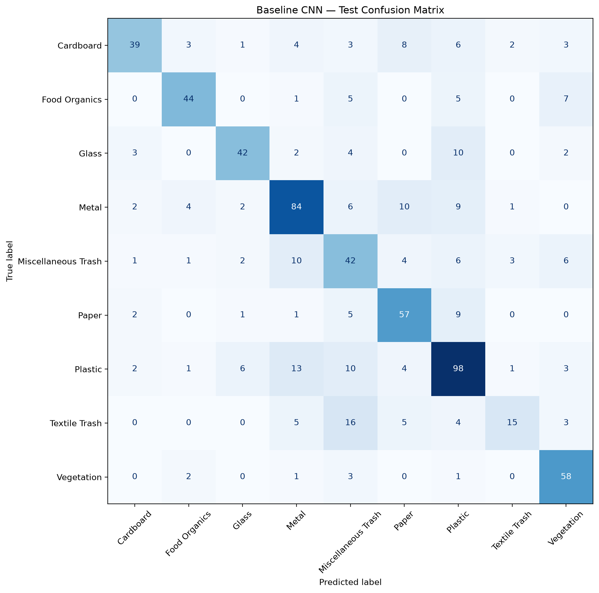
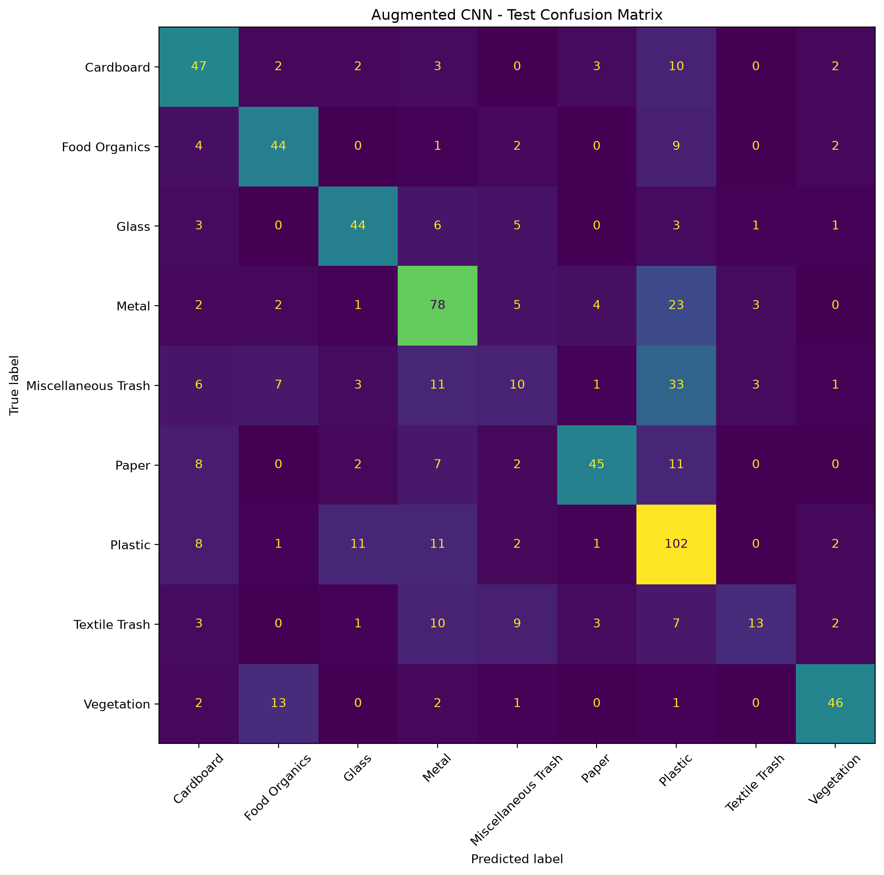
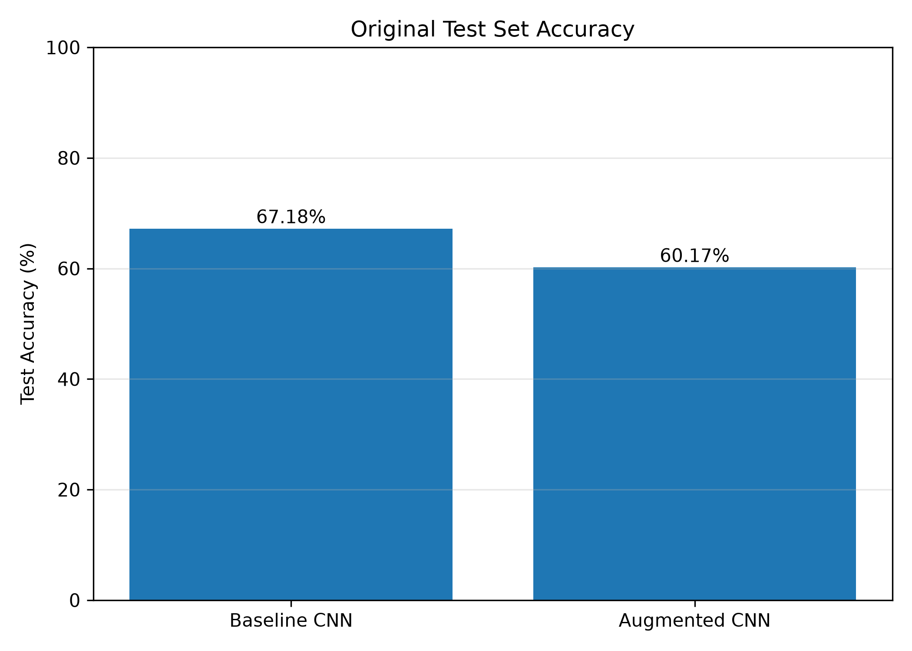
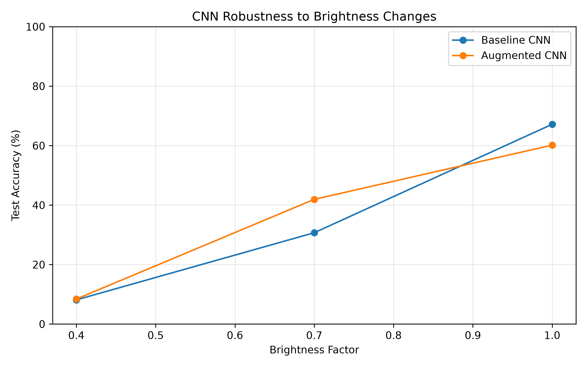
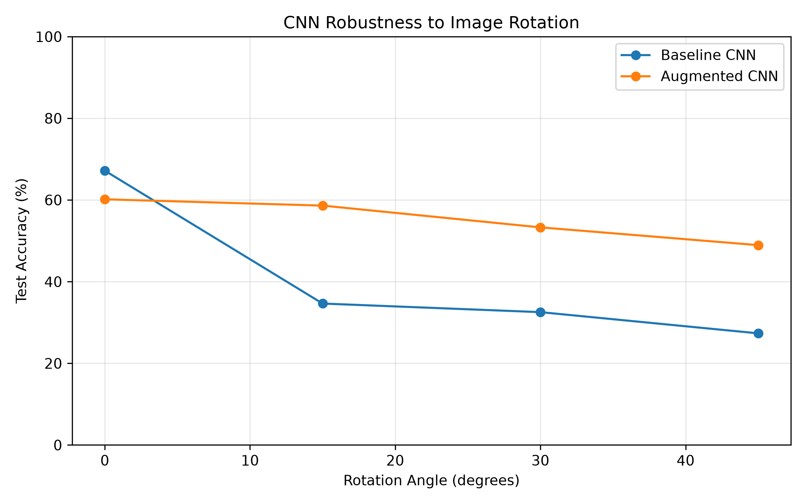
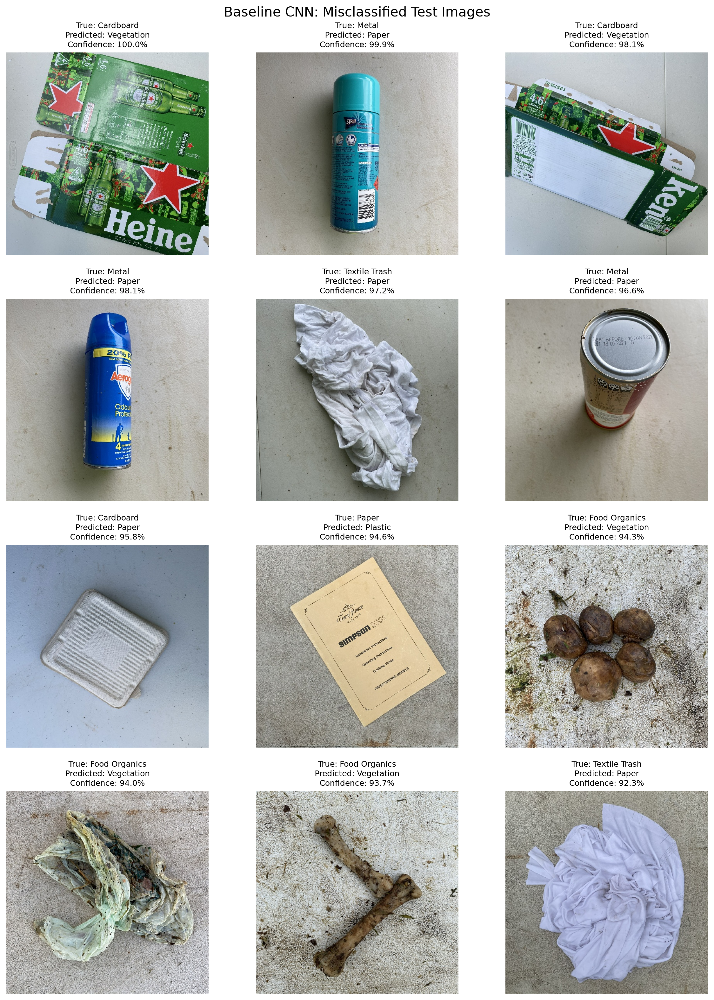
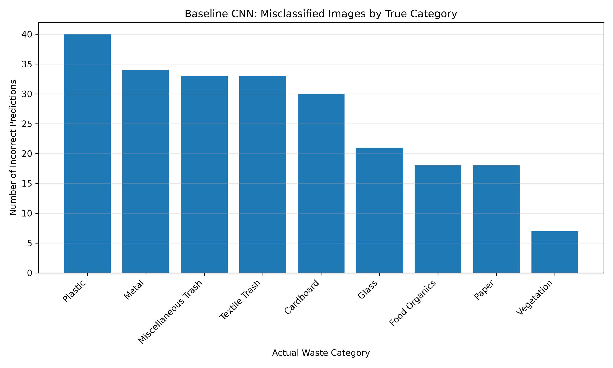

# How Much Can a CNN Trust a Waste Image? Evaluating CNN Reliability on Real-World Waste Images

## Abstract

This project investigates the reliability of convolutional neural networks (CNNs) for classifying waste images into nine categories using the RealWaste dataset. A baseline CNN trained on original images was compared with a CNN trained using data augmentation. Both models were evaluated on the same held-out test set and tested under changes in image brightness and rotation. The baseline model achieved 67.18% accuracy on the original test images, while the augmented model achieved 60.17%. However, the augmented model performed better under moderate brightness reduction and image rotation. At 45 degrees of rotation, it achieved 48.95% accuracy, compared with 27.35% for the baseline. Both models performed poorly on very dark images and struggled with certain waste categories. These findings show that overall accuracy alone does not fully measure model reliability and that robustness testing and failure analysis are important for understanding CNN behavior.

## 1. Introduction

Waste sorting is an important part of recycling, but identifying different types of waste from images is not always easy. Some materials look similar, and image conditions such as lighting and object orientation can make classification more difficult.

In this project, I built and tested two Convolutional Neural Network (CNN) models to classify waste images into nine categories. The first model is a baseline CNN trained on the original images. The second model uses data augmentation, including random rotations, horizontal flips, and changes in brightness and contrast during training.

I wanted to find out whether the augmented model could handle changes in image conditions better than the baseline model. I compared their performance on the same test dataset and then tested both models using darker and rotated images.

### 1.1 Research Question

How does a CNN's classification reliability change when classifying real-world waste images, and can data augmentation improve its robustness?

### 1.2 Project Objectives

The main objectives of this project are:

- Build a baseline CNN to classify waste images.
- Train a second CNN using data augmentation.
- Compare the performance of both models on unseen test images.
- Test how changes in brightness and rotation affect classification accuracy.
- Examine the results to understand where the models make mistakes.

## 2. Dataset and Methodology

### 2.1 Dataset

For this project, I used the RealWaste dataset introduced by Single et al. (2023). The dataset contains images of waste materials grouped into nine categories: Cardboard, Food Organics, Glass, Metal, Miscellaneous Trash, Paper, Plastic, Textile Trash, and Vegetation.

The dataset contains 4,752 images in total. Plastic has the largest number of images, while Textile Trash has the smallest number. This difference in class sizes may affect how well the model learns each category.

Before training, I checked that the images could be opened and used them to create training, validation, and test sets. The data was split using a fixed random seed of 42 so that the same split could be reproduced.

### 2.2 Data Splitting and Preprocessing

The dataset was divided into three groups:

- Training set: 3,326 images
- Validation set: 713 images
- Test set: 713 images

All images were resized to 128 × 128 pixels and converted to tensors before being passed to the CNN. The training set was used to learn model parameters, while the validation set was used to track performance during training and select the best checkpoint. The test set was kept separate for the final evaluation and robustness experiments.

### 2.3 Baseline CNN

The baseline model uses three convolutional layers with 16, 32, and 64 filters. Each convolutional layer is followed by a ReLU activation and max-pooling operation. The extracted features are passed to a fully connected layer with 128 units, followed by dropout and the final classification layer.

The model was trained using cross-entropy loss and the Adam optimizer with a learning rate of 0.001. Training was performed for up to 10 epochs with a batch size of 32.

### 2.4 CNN with Data Augmentation

The second model uses the same CNN architecture and training settings as the baseline model. The difference is that random transformations were applied to training images. These included horizontal flipping, rotations of up to 10 degrees, and changes in brightness and contrast.

The purpose of these transformations was to expose the model to more variations during training and investigate whether this would improve its performance on images with changed conditions. Validation and test images were not augmented during the normal evaluation.

### 2.5 Evaluation Approach

Both models were evaluated on the same held-out test set of 713 images. I used accuracy, precision, recall, and F1-score to compare their classification performance. Confusion matrices were also generated to identify categories that the models frequently confused.

To test robustness, I evaluated the models using darker images and rotated images. For brightness testing, the brightness factors were 1.0, 0.7, and 0.4. For rotation testing, the images were rotated by 0, 15, 30, and 45 degrees. The same test images were used across conditions so that the results could be compared fairly.

## 3. Results and Discussion

### 3.1 Baseline and Augmented Model Comparison

The baseline CNN achieved a test accuracy of 67.18%, while the augmented CNN achieved 60.17%. In this experiment, the baseline model performed better on the original test images.

The augmented model did not improve the overall test accuracy. However, accuracy alone does not show how well a model handles changes in image conditions. For this reason, I also tested both models using different brightness levels and image rotations.

### 3.2 Brightness Robustness

I tested both models using the original test images and two darker versions, with brightness factors of 0.7 and 0.4. A factor of 1.0 represents the original brightness, while lower values represent darker images.

| Brightness factor | Baseline accuracy | Augmented accuracy |
|---|---:|---:|
| 1.0 | 67.18% | 60.17% |
| 0.7 | 30.72% | 41.94% |
| 0.4 | 8.13% | 8.42% |

The baseline model performed better on the original images, but its accuracy dropped sharply when the images became darker. At a brightness factor of 0.7, the augmented model performed better by 11.22 percentage points. At 0.4 brightness, both models performed very poorly.

These results suggest that augmentation helped the model handle moderate brightness changes, but it did not provide enough protection against very dark images.

### 3.3 Rotation Robustness

I also tested the models using image rotations of 0, 15, 30, and 45 degrees.

| Rotation | Baseline accuracy | Augmented accuracy |
|---|---:|---:|
| 0° | 67.18% | 60.17% |
| 15° | 34.64% | 58.63% |
| 30° | 32.54% | 53.30% |
| 45° | 27.35% | 48.95% |

The baseline model's accuracy decreased considerably as the rotation angle increased. The augmented model maintained higher accuracy at all three nonzero rotation angles.

At 45 degrees, the augmented model achieved 48.95% accuracy, compared with 27.35% for the baseline. This is a difference of 21.60 percentage points.

This result suggests that training with random rotations helped the augmented model become more robust to rotated images, even though its accuracy on the original test set was lower.

### 3.4 Overall Findings

The experiments showed a trade-off between performance on original images and robustness to image transformations. The baseline model performed better on the original test set, while the augmented model handled moderate brightness changes and rotations more successfully.

However, both models struggled with very dark images. The results also varied across waste categories, so the overall accuracy does not fully describe their reliability. The next section examines the classification errors in more detail.

## 4. Failure Analysis

The confusion matrix helped me understand which waste categories were difficult for the augmented CNN to classify correctly.

Miscellaneous Trash was the weakest category, with an F1-score of 0.18. Out of 75 test images in this category, only 10 were classified correctly. The model predicted 33 of these images as Plastic.

Textile Trash was also difficult to classify: only 13 out of 48 images were correctly identified. Ten Textile Trash images were predicted as Metal, and nine were predicted as Miscellaneous Trash.

The model also confused Metal with Plastic, predicting 23 Metal images as Plastic. Similarly, 13 Vegetation images were classified as Food Organics.

These errors suggest that some waste categories may share visual characteristics that make them difficult to distinguish. However, inspecting the misclassified images would be necessary to understand the exact reasons for these errors.

The results also show why accuracy alone is not enough to evaluate a classifier. A model may perform reasonably well overall while struggling with particular categories. In a waste-sorting application, these category-specific errors could matter because different materials may need different recycling or disposal methods.

### 4.1 Baseline CNN Errors by Category

The baseline CNN misclassified 234 of the 713 test images. Plastic had the largest number of incorrect predictions, with 40 errors, followed by Metal with 34 errors. Miscellaneous Trash and Textile Trash each had 33 errors, while Cardboard had 30. Vegetation had the fewest errors, with seven misclassified images.

These counts show where the baseline model made the most errors in absolute numbers. However, they do not necessarily identify the categories with the lowest classification accuracy because each category contains a different number of test images. Considering both the number of errors and the number of images in each category provides a more complete picture of model performance.

## 5. Limitations

This project has several limitations. First, both models were trained for only 10 epochs, so additional training and hyperparameter tuning might change their performance. Second, the experiments used a single train-validation-test split and one random seed. Results may differ with other splits or training runs.

The robustness experiments tested only selected brightness factors and rotation angles. They do not represent every condition that waste images might encounter in real-world settings. The transformations were applied to the test images to evaluate robustness, but this does not establish how the models would perform on every naturally occurring change in lighting or orientation.

Finally, the models were evaluated on one dataset, so their performance on images collected from other sources remains unknown. The results should therefore be interpreted as findings from these experiments rather than proof that either model will perform equally well in every real-world waste-sorting environment.

## 6. Ethics, Limitations, and Responsible Use

Automated waste classification could help support recycling workflows, but incorrect predictions may cause recyclable materials to be sorted incorrectly. The models developed in this project should therefore be treated as experimental tools rather than replacements for human judgment or established waste-handling procedures.

The RealWaste dataset may not represent every waste-management facility, geographic region, lighting condition, or type of waste. Performance may vary when images differ from those used during training and evaluation. The experiments showed substantial accuracy reductions under very low brightness, demonstrating that predictions can become unreliable under challenging conditions.

Responsible deployment would require testing on representative images from the intended environment, monitoring category-specific errors, and providing a fallback for uncertain predictions. Human review should remain available for ambiguous cases. Data collection should also respect applicable privacy requirements, especially if images capture people or identifying information. Finally, the environmental benefits of automated sorting should be considered alongside the computational resources required to train and operate the models.

These considerations limit the conclusions that can be drawn from the current experiments. Further validation on diverse waste images and real-world sorting conditions would be necessary before using the models in operational settings.

## 7. Conclusion

In this project, I compared a baseline CNN with a CNN trained using data augmentation for classifying waste images into nine categories. The baseline model achieved 67.18% test accuracy, while the augmented model achieved 60.17%.

Although the baseline performed better on the original test images, the augmented model was more robust to the rotations tested. At 45 degrees, the augmented model achieved 48.95% accuracy, compared with 27.35% for the baseline. It also performed better on moderately darker images, although both models struggled when brightness was reduced further.

The results suggest that data augmentation can improve robustness to certain image transformations, but it does not guarantee higher overall classification accuracy. The models also struggled with categories such as Miscellaneous Trash and Textile Trash.

Overall, this project showed me that evaluating a CNN requires more than measuring accuracy on original images. Testing changed image conditions and examining classification errors provides a better understanding of the model's strengths and limitations.

## 8. Future Work

Future work could include training for more epochs, tuning the learning rate and augmentation settings, and inspecting misclassified images in greater detail. Testing additional image transformations and evaluating the models on a separate dataset could also help determine how well the results generalize to real-world waste images.

Another useful improvement would be to compare the custom CNN with a pretrained model using transfer learning. This could help determine whether a model that starts with features learned from a larger image dataset performs better on waste classification. Repeating the experiments with multiple random seeds would also provide a clearer picture of how consistent the results are.

## 9. Figures

### Figure 1. Baseline CNN Confusion Matrix

This figure shows the classification performance of the baseline CNN across the nine waste categories. The confusion matrix helps identify which categories were correctly classified and which were confused with other categories.

### Figure 2. Augmented CNN Confusion Matrix

This figure shows the classification performance of the augmented CNN. Miscellaneous Trash and Textile Trash were among its most difficult categories.

### Figure 3. Original Test Accuracy Comparison

The baseline CNN achieved 67.18% accuracy on the original test images, compared with 60.17% for the augmented CNN.

### Figure 4. Brightness Robustness Comparison

The augmented CNN performed better at a brightness factor of 0.7. However, both models experienced a major drop in accuracy at a factor of 0.4.

### Figure 5. Rotation Robustness Comparison

The augmented CNN maintained higher accuracy as the rotation angle increased. At 45 degrees, it achieved 48.95% accuracy, compared with 27.35% for the baseline CNN.

### Figure 6. Baseline CNN Misclassified Images

This figure shows examples from the test set that the baseline CNN classified incorrectly. Each image includes its actual category, predicted category, and the model's confidence in its prediction. These examples help illustrate the classification errors that contribute to the model's overall error rate.

### Figure 7. Baseline CNN Misclassified Images by Actual Category

The graph compares the number of incorrect predictions across the nine waste categories.

## 10. References

Single, S., Iranmanesh, S., & Raad, R. (2023). RealWaste: A Novel Real-Life Data Set for Landfill Waste Classification Using Deep Learning. Information, 14(12), Article 633. https://doi.org/10.3390/info14120633

Single, S., Iranmanesh, S., & Raad, R. (2023). RealWaste [Dataset]. UCI Machine Learning Repository. https://doi.org/10.24432/C5SS4G